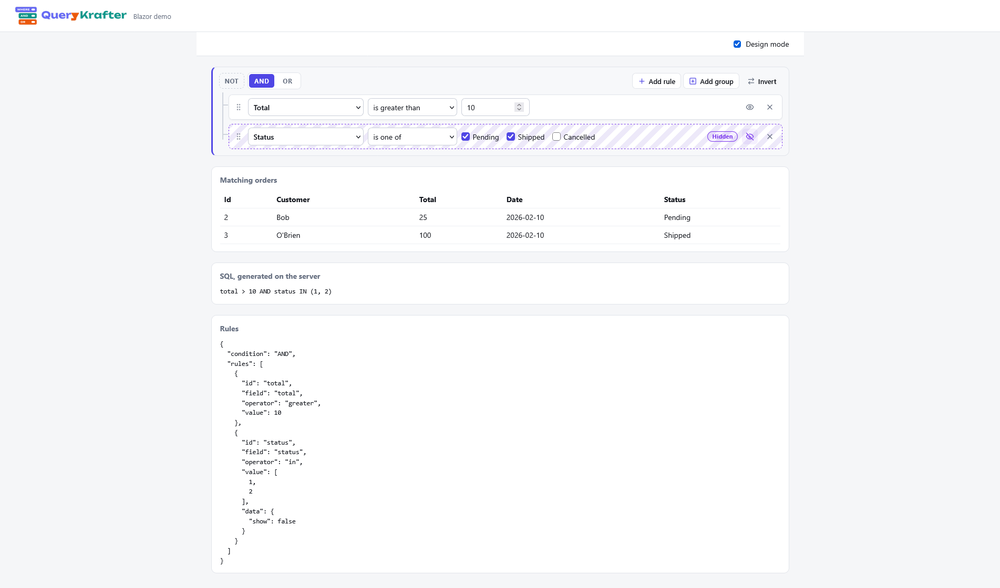

A query builder for .NET. People compose rules over fields you define; you turn those rules into SQL or a LINQ predicate on the server, from a configuration you trust.

## Screenshot


The same component works in **Blazor**, **ASP.NET Core MVC / Razor Pages**, and, as a custom element, in **React or any plain HTML page**.

## Projects

| Project | What it is |
| --- | --- |
| `QueryKrafter.Core` | Rules, configuration, validation, SQL, LINQ, and the language catalogs. No UI. |
| `QueryKrafter.Components` | The `QueryBuilder` Razor component and the `QueryBuilderElement` string-parameter wrapper. |
| `QueryKrafter.CustomElements` | A Blazor WebAssembly app that registers `<qk-query-builder>`. |
| `QueryKrafter.Demo.Blazor` | Blazor Server demo that filters a list of orders. |
| `QueryKrafter.Demo.Mvc` | MVC demo. The view posts the rules; the controller generates the SQL. |
| `querykrafter.demo.react` | React (Vite) demo using the custom element. |
| `QueryKrafter.Tests` | xUnit tests for JSON, validation, SQL (including SQLite), LINQ, and languages. |

## Blazor

```csharp
builder.Services.AddQueryKrafter();
```

```html
<link rel="stylesheet" href="@Assets["_content/QueryKrafter.Components/querykrafter.css"]" />
```

```razor
<QueryBuilder Config="config" @bind-Rules="rules" OnChanged="OnChanged" DesignMode="designMode" />
```

`Config` is yours and stays on the server. Turn the rules into SQL or a LINQ predicate there; see [SQL and LINQ](#sql-and-linq).

## SQL and LINQ

The builder stores rules as JSON ([jQuery QueryBuilder](https://querybuilder.js.org/) format). On the server, parse that JSON and pair it with a **configuration you trust**. Each filter's `id` is what appears in the rules; `Field` is the SQL column (or expression) written into the `WHERE` clause; `Property` is the C# member used for LINQ. The `field` property inside posted rule JSON is ignored for both paths.

Define filters once:

```csharp
var config = new QueryBuilderConfig
{
    Filters =
    [
        new() { Id = "customer", Field = "customer", Property = nameof(Order.Customer) },
        new() { Id = "total", Field = "total", Type = QueryValueType.Double, Property = nameof(Order.Total) },
        new() { Id = "status", Field = "status", Type = QueryValueType.Integer, Property = nameof(Order.Status) },
    ],
};

var parsed = QueryJson.TryParse(rulesJson);
if (!parsed.IsSuccess)
{
    // validation errors from malformed JSON or unknown operators
    return;
}

QueryGroup rules = parsed.Value;
```

### SQL

`SqlGenerator.Generate` validates the rules, then returns a `SqlQuery`: a `WHERE` fragment (without the keyword) and named parameters (`@p1`, `@p2`, … by default). Use parameters when you execute the query; `ParameterStyle = Inline` is for display only (demos and previews).

```csharp
var generated = SqlGenerator.Generate(rules, config, new()
{
    Dialect = SqlDialect.SqlServer,
    ParameterStyle = SqlParameterStyle.Named,
});

if (!generated.IsSuccess)
{
    return;
}

SqlQuery where = generated.Value;
// where.Sql might be: [customer] = @p1 AND [total] > @p2
// where.Parameters: p1 = "Ann", p2 = 10

string sql = where.IsEmpty
    ? "SELECT * FROM orders"
    : $"SELECT * FROM orders WHERE {where.Sql}";

using var command = connection.CreateCommand();
command.CommandText = sql;
foreach (var parameter in where.Parameters)
{
    command.Parameters.AddWithValue("@" + parameter.Name, parameter.Value ?? DBNull.Value);
}

// Or with Dapper: connection.Query<Order>(sql, where.ToDictionary());
```

Set each filter's `Field` to the exact SQL you want (quoted identifier, table alias, expression). It is copied verbatim into the generated SQL, so never build `Field` from user input.

### LINQ

`ApplyQuery` builds an `Expression<Func<T, bool>>`, validates first, and filters your data. On `IEnumerable<T>` the predicate is compiled; on `IQueryable<T>` the expression tree is passed to `.Where`, so Entity Framework (and similar providers) can translate it to SQL.

```csharp
// In-memory list (Blazor demo: matching orders table)
var filtered = orders.ApplyQuery(rules, config);
if (filtered.IsSuccess)
{
    foreach (var order in filtered.Value)
    {
        // ...
    }
}

// EF Core — same rules, translated by the provider when possible
var queryResult = db.Orders.AsQueryable().ApplyQuery(rules, config);
if (queryResult.IsSuccess)
{
    List<Order> rows = await queryResult.Value.ToListAsync(cancellationToken);
}
```

For a raw expression (custom providers, tests, logging):

```csharp
Result<Expression<Func<Order, bool>>> built = QueryExpressionBuilder.Build<Order>(rules, config);
if (built.IsSuccess)
{
    Func<Order, bool> predicate = built.Value.Compile();
}
```

Building expressions uses reflection to resolve `Property` names. Methods that do this are annotated for trimming and Native AOT (`RequiresUnreferencedCode` / `RequiresDynamicCode`).

Hidden rules (`data.show: false` in design mode) are still validated and still appear in both the SQL and the LINQ predicate.

## MVC

Render `QueryBuilderElement` with `render-mode="Server"`. Set `param-Name` so the rules JSON is posted with the form, then parse the rules and call `SqlGenerator.Generate` and/or `ApplyQuery` in the action. See `QueryKrafter.Demo.Mvc`.

## React and plain HTML

Publish `QueryKrafter.CustomElements` and serve its `wwwroot`. The page needs the stylesheet, then:

```html
<qk-query-builder id="builder" design-mode="true" sql-dialect="sqlite"></qk-query-builder>
<script src="_framework/blazor.webassembly.js"></script>
<script>
  builder.setAttribute('config', JSON.stringify({ filters: [{ id: 'total', type: 'double' }] }));
  builder.addEventListener('qk-changed', e => console.log(e.detail));
</script>
```

`e.detail` is `{ rules, isValid, errors, sql }`. `sql` is a preview from the configuration in the page. Generate the SQL you execute on the server, from your own configuration.

Attributes are kebab-case: `design-mode`, `read-only`, `sql-dialect`, `parameter-style`, `show-errors`, `language`, `theme` (`light`, `dark`, `auto`, `bootstrap`).

## Design mode

`DesignMode` shows a hide button on each rule. A hidden rule is stored as `data.show: false`, is still validated, and is still part of the SQL and the LINQ predicate. Outside design mode it is not shown, and a group whose rules are all hidden cannot be edited.

## Languages

English, German, Spanish, French, Brazilian Portuguese, and Simplified Chinese are built in. `AddQueryKrafter(o => o.Directory = "Locales")` loads extra `{tag}.json` files, which override the built-in strings key by key.


## Support

If you find this project useful, consider supporting its development.

<p align="center">
  <a href="https://buymeacoffee.com/vnmatt">
    
  </a>&nbsp;&nbsp;&nbsp;
  <a href="https://www.paypal.com/cgi-bin/webscr?cmd=_donations&business=gordon_matt%40live%2ecom&lc=AU&currency_code=AUD&bn=PP%2dDonationsBF%3abtn_donateCC_LG%2egif%3aNonHosted">
    
  </a>
</p>

<p align="center">
  Prefer using your phone? Scan the QR code:
</p>

<p align="center">
  <a href="https://buymeacoffee.com/vnmatt">
    
  </a>
</p>


